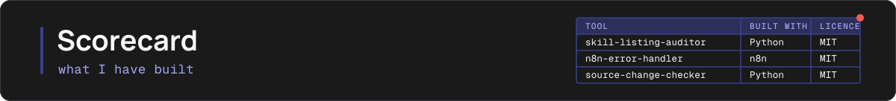
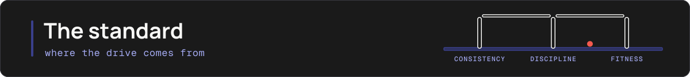
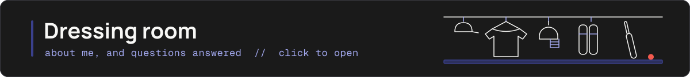

<picture></picture>

Divyansh Tomar builds business systems, and writes the documents that run them. Three small tools are below. Run them.

<picture></picture>

- **[skill-listing-auditor](https://github.com/divyanshtomar1610/skill-listing-auditor)** shows which Claude Code skills your agent has quietly stopped seeing.
- **[n8n-error-handler](https://github.com/divyanshtomar1610/n8n-error-handler)** is one n8n workflow that catches the others when they fail, and doesn't repeat the same alert.
- **[source-change-checker](https://github.com/divyanshtomar1610/source-change-checker)** watches a fixed list of web sources. A failed fetch is a failure, never "no news".

## Connect

Build this kind of thing too, or have a system that keeps breaking? Message me on **[LinkedIn](https://www.linkedin.com/in/divyanshtomarr)**. Say what you're building, or what's broken and what you've already tried.

<picture></picture>

Three things taken from years of watching No. 18 bat, and where each one shows up in the work.

- **Consistency.** Same routine on a good day and a bad one. The source checker is built to run on a schedule, not on a mood.
- **Discipline.** The dull step goes first. Each repo's README says what the tool is for and how to check it worked, before you run anything.
- **Fitness.** Staying ready is work too. The error handler's guide has you build a fault injector, so the alert path gets proved again after every change.

<picture></picture>

 

Most of what I build was never meant to be looked at. It's meant to run.

Across my career I've built growth and automation systems for 300+ brands. These days the work goes out under Tendsweb, in market since 2018.

I'd rather show you something I built than tell you what to build.

Based in India. Reserved in person. The documentation does most of the talking.

**What tools?**

n8n for the workflows. Claude Code for agent work. Python when a job has to be exact, usually with nothing outside the standard library. Notion and Slack for the logs and the alerts. The tool matters less than the document that says what it's for.

**Are the repos free to use?**

Yes. Each one carries the MIT licence. Take what's useful, and tell me what broke.

**Why the cricket?**

A run chase is the most honest picture of the work I know. The target is on the board, the balls are counted, and the scoreboard doesn't care how the innings felt. The art is original line work and a fan's tribute. Nothing official about it.

<picture></picture>

Fan tribute. Original line work, not affiliated with or endorsed by any player, team or board.
